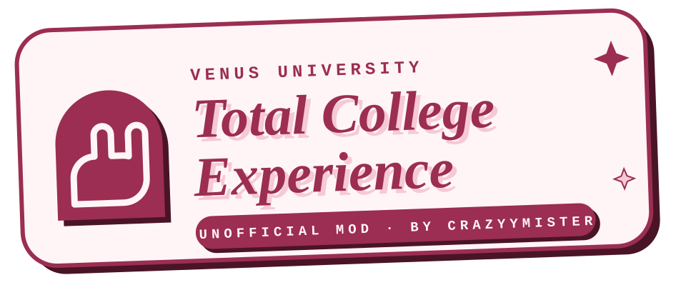

  

# Venus University: Total College Experience

**An unofficial mod of [Venus University](https://venus-dev.itch.io/venus-university) by CrazyyMister.**

Total College Experience (TCE) turns Venus University into a fuller college sim: men on the roster, characters who fall for each other, a feed and a phone that answer back, teams, Greek life, housing, seasons, a bigger roster and a memory the writer can lean on, all on top of the original dating sim. It is a complete game with its own program and its own data folder, built from Venus University 0.2.0.

> **This is not the official game.** Please report TCE bugs [here](https://github.com/CrazyyMister/total-college-experience/issues), not to the original developer. Saves do not move between TCE and the official game in either direction, and future TCE versions may not open saves from this one.

> **18+ only.** Like the original, TCE is an adult game, with explicit scenes. All characters are adults (18+).

## Support the original developer

Venus University is made by **Venus Dev** (venusdev), who gave permission for TCE to exist. TCE would not exist without their work. If you enjoy it, please support them:

- **itch.io:** [Venus University](https://venus-dev.itch.io/venus-university)
- **Ko-fi:** [ko-fi.com/venusdev](https://ko-fi.com/venusdev)
- **X:** [@venus_uni_game](https://x.com/venus_uni_game)
- **Official source:** [github.com/venus-uni-dev/venus-university](https://github.com/venus-uni-dev/venus-university)

## What TCE adds

### Your story
- **Breakthrough.** Every character carries a meter that fills from the good memories she keeps of you. When it is full, you can push a scene hard in the direction you choose. The game judges how it went and remembers it.
- **Memory with encounters and facts.** Characters remember the scenes they were in with you, who else was there and where. Lasting facts (her family, a promise, a secret) are kept with who knows them and whether they really happened or were only said. You can correct any of it from her contact page.
- **An ex-girlfriend.** Start the semester with an ex from the roster, on good or bad terms. Her history is written by the game, dated before the first day.
- **Your course.** Pick a course at New Game from a list of fifteen; the registrar offers four classes of it.

### The people
- **Men on the roster.** A character has a gender and who she or he is attracted to, chosen when you create the character and changeable in the editor. Men are written with their own pronouns and drawn as men. They are friends, teammates and rivals; the reader is always a man, and men are not his romance options.
- **Romance between the roster.** Characters fall for one another off-screen: crushes, couples, turn-downs, breakups and exes. The writer knows about them, they show up in posts and on contact pages, and anonymous students gossip about them. You can play wingman by your words, helping a pair along or getting in their way. A girlfriend who drifts away from you can leave, and the man she turns to becomes your rival.

### The phone
- **A feed that answers back.** Post to the Bunnyboard (one post per half-day, up to 280 characters) and get likes and replies in the next slot. Comment on your contacts' posts, and they comment on each other's and sometimes tag you in a post about the scene you just shared. What matters in these exchanges becomes something they remember.
- **Photos in texts.** Characters can text you a photo (a selfie, a mirror shot, something from their day and, for those close enough to you, spicier ones) and an invitation can carry one. They are drawn by your local ComfyUI, and you can regenerate one you do not like. A switch in Settings turns them off.

### The campus
- **A roster of 12 to 16** characters, with a setup screen for everything you choose before the semester starts.
- **Seasons.** The semester has a winter, until mid-March, and a spring. Characters can have a winter outfit and a team uniform you design in the character editor.
- **Housing.** The game tracks where everybody lives, in the dorms or in a Greek house, and remembers when you move.
- **Fuller weeks.** Busy places hold more than one person at a time, and anything the week cannot fit is reported instead of silently dropped.

### Teams
- **Women's swimming and volleyball**, which you ask for at New Game, with practices and meets against Port Calder that you can go and watch.
- **Men's basketball and football**, always there, which you can try out for in the first week. Make the team and you practice twice a week, get texts from your coach, and play games against Ashgrove (basketball) and Redmere (football). Miss three practices and you are off the team. When you play, your Body and the practices you went to help decide the score.
- Every result is decided by the game before the scene starts, so the story never contradicts the scoreboard.

### Greek life
- **Four houses on Laurel Row:** two fraternities (Kappa Row and Xi Delt) and two sororities (Sig Lam and Pi Theta), each with its own members and four officers.
- **Rush, bid, pledge, initiation.** Go to a fraternity's rush events in the first two weeks, earn a bid, go to its pledge meetings through the sixth week, and get initiated in the seventh. Then move into your own room in the house. Miss three meetings and you are put out; you can also leave, as a pledge or as a member. The sororities do not rush the reader.
- **Parties and mixers** from the third week on, and **Greek Week** at the end of April: four nights of competition between the four houses.

### Under the hood
- Everything the game can decide (who, when, results, chances) is decided by code and saved, so the writer only narrates and reloading a save never changes an outcome.
- Unnamed teammates, coaches, house members and judges stay unnamed, so the writer does not invent people who then show up in memories.
- New background art for the Greek houses, and a Settings button that cleans up photos no save uses.

## Requirements

- Windows 10 or 11.
- An NVIDIA GPU, or an AMD GPU of the RDNA 3 or RDNA 4 family, for the local image generation (optional for playing, needed to create characters).
- A Google Gemini API key, or any endpoint that speaks the OpenAI chat completions format (for example OpenRouter).

TCE uses generative AI. The text model you choose writes the scenes, and your local ComfyUI draws the characters and the photos. The new images of the Greek houses were also made with AI.

## Installing

1. Download the latest release from [RELEASE_URL](RELEASE_URL) and unzip it. The zip makes its own folder, `Total College Experience`. **Never unzip it into or over the official Venus University folder:** it would replace the official game's files.
2. Run `Total College Experience.exe`. Windows may warn that the app is unrecognized, because it is not code-signed; choose **More info → Run anyway**.
3. Enter your API key on the first screen, then set up image generation from the Setup screen. TCE downloads its own ComfyUI the same way the original does.
4. If you already have the official Venus University with its image generation installed, TCE can use that ComfyUI instead of downloading its own. On the Setup screen, under WHERE COMFYUI LIVES, choose **Use the official game's ComfyUI** and pick the official game's folder, the one with `Venus University.exe`. TCE only reads from it: it keeps its own images and files in its own `data` folder and never installs into the official game's. **Use it only while the official game is closed.** If the official game is open it takes the image generation TCE started for its own, and the two stop working together.

TCE keeps its data in a `data` folder beside its own program and does not touch the official game's saves.

**Updating.** Close the game and unzip the new release in the same place as before, letting it replace the files of the `Total College Experience` folder. Your saves, settings and characters stay: they live in its `data` folder, which the zip does not contain.

**The music.** TCE does not include the game's music. If you have the official game, copy its `resources\assets\sound\music` and `resources\assets\sound\ambient_music` folders into TCE's `resources\assets\sound` folder, then restart TCE. The two games lay their files out the same way.

**One game at a time.** TCE and the official game can both be open, but only one of them can run image generation at a time, because both use port 8188 on your computer. If the other game has it, TCE says which game and does not touch it; close that game and try again.

**Other mods.** TCE does not work together with other code mods, such as Maestro's Community Mods or the Photo Feature mod. It is a complete game on its own, not a patch for the official one. An update to the official game never changes TCE, and TCE does not update itself: a new version is a new download.

## Reporting bugs

Open an issue at [github.com/CrazyyMister/total-college-experience/issues](https://github.com/CrazyyMister/total-college-experience/issues). The game's **Feedback** button lets you download your log file; attach it to the issue. Your folder paths are replaced with placeholders in the log and the app does not write your API key to it, but have a look before you post it.

## Credits

- **Venus University** by Venus Dev. All the original code, characters, art and sound are theirs.
- **Total College Experience** by CrazyyMister.
- Breakthrough and the encounters-and-facts memory were inspired by maestroleeds' [Maestro's Community Mods](https://github.com/maestromods/maestros-community-mods), which also had an ex feature first; TCE's ex was built separately.
- Thanks to the Venus University community.

The full credits, with the music, sounds, image models and tools, are on the game's Credits screen.

## License

- The code is licensed under AGPL-3.0-only; see [LICENSE](LICENSE). This repository is the source of every TCE release.
- The images, sounds and characters of Venus University are Venus Dev's and are not covered by the AGPL. TCE includes them with Venus Dev's permission; see [PERMISSION.md](PERMISSION.md) and [LICENSE-ASSETS.md](LICENSE-ASSETS.md). The images TCE adds are CC BY-NC 4.0.
- [NOTICE](NOTICE) says what was changed, from what, and who made what.
